# Фабрика приложений: агентский конвейер «бизнес-требования → работающий прототип»

Конвейер принимает формализованные бизнес-требования (и, при наличии, файлы данных) и выдаёт репозиторий с
согласованными системным анализом, моделью данных, API, backend (C# / ASP.NET Core, .NET 10), web-интерфейсом
(Angular 20 + Angular Material), Android-приложением (Kotlin 2.2, Jetpack Compose), PostgreSQL/PostGIS, Kafka,
тестами, Docker, GitLab CI/CD и документацией. Генерацию выполняет **Qwen3.8-27B**.

## Идея: компилятор требований

LLM хорошо понимает требования и принимает решения, но 27B-модель ненадёжно удерживает согласованность сотен файлов
на свежих версиях стека. Поэтому:

1. **Агенты Qwen** превращают требования в строгую модель приложения (IR, `spec.yaml`): сущности, права, операции,
   события, экраны, критерии приёмки, демо-сценарий. Ответы строго по JSON-схеме — ноль повторов из-за формата.
2. **Детерминированные генераторы** по корпоративным шаблонам строят из IR backend, БД, OpenAPI/AsyncAPI, web,
   мобильное приложение, Docker, CI и документацию. Документы, API и код описывают одно поведение по построению.
3. **Агент-программист** пишет только уникальную бизнес-логику (тела операций и фоновых задач) — по одному небольшому
   вызову на метод, параллельно; ошибки компилятора возвращаются ему точечно.
4. **Агент-тестировщик** собирает и тестирует проект, разворачивает стенд, прогоняет демо-сценарий из требований через
   настоящий API и отдаёт программисту упавшие шаги вместе с исключениями сервера (самовосстановление).

```mermaid
flowchart LR
  R[Требования + данные] --> A[Аналитик<br/>анализ, ФТ, критерии, вопросы]
  A --> Q[Уточняющие вопросы<br/>с ответами по умолчанию]
  Q --> D[Архитектор<br/>модель данных + поведение]
  D --> V[Проверка IR<br/>автоисправления + точечный ремонт]
  V --> G[Генераторы<br/>.NET, Angular, Kotlin, SQL, Docker, CI, доки]
  G --> C[Программист<br/>бизнес-логика]
  C --> B[Сборка ↔ исправление]
  B --> T[Тесты, стенд, демо-сценарий ↔ исправление]
  T --> P[Документация, отчёты, публикация]
```



## Запуск

Требования: Python 3.12 + [uv](https://docs.astral.sh/uv/), Docker. Ключ модели — в `factory/.env` (см. `.env.example`).

```bash
cd factory
uv sync
uv run factory serve            # веб-интерфейс: http://localhost:8000
uv run factory run ../cases/case1   # прогон из командной строки
```

Результат: `out/<slug>/` — готовый проект (`docker compose up -d --build`), журнал прогона: `runs/<id>/`.

## Веб-интерфейс

Вставьте требования (или выберите кейс), приложите данные, нажмите «Запустить». В ленте «Агенты конвейера» видно,
какой агент работает и что он сделал, справа — расход токенов, вызовы, повторы и время, слева — история прогонов.
Уточняющие вопросы приходят с вариантом по умолчанию; архитектор начинает работу сразу с ответами по умолчанию и
перепроектирует, только если ответ заказчика их меняет. По завершении — сводка (сборка, тесты, демо), документы
по разделам, QR-код APK, кнопка «Развернуть и открыть» и архив проекта. Светлая и тёмная темы.

## Что получает заказчик

| Артефакт | Где |
|---|---|
| ТЗ по регламенту СА (шаблон ТЗ: UseCase, PlantUML, ФТ с трассировкой, спецификация ЭФ, БД, API, НФТ 4.1–4.5) | `docs/01-system-analysis.md` |
| Описание сервиса (шаблон описания сервисов), ADR (шаблон ADR), методы API (шаблон API) | `docs/service.md`, `docs/adr/`, `docs/api/methods/` |
| Продукт, архитектура, API, модель данных, события | `docs/02…06`, `docs/asyncapi.yaml` |
| Backend: Domain / Application / Infrastructure / Api, тесты | `backend/` |
| Web-интерфейс на Angular Material с проверкой UI Kit | `frontend/` |
| Android-приложение | `mobile/` |
| Mock-сервисы внешних систем | `mocks/` |
| Docker Compose, GitLab CI (сборка, тесты, SAST/SCA/секреты, образы, стенд) | `docker-compose.yml`, `.gitlab-ci.yml` |
| Отчёты: тестирование, безопасность (реальные находки NuGet / npm / Gitleaks / анализаторов .NET с итоговым статусом), трассировка, самооценка, расход конвейера | `docs/10…12`, `docs/traceability.md`, `docs/jury-scorecard.md`, `docs/pipeline-report.md` |
| Мониторинг: `/metrics` (Prometheus), `/health` Healthy / Degraded / Unhealthy, перезапуск `POST /api/v1/admin/restart` | backend |
| Демо-сценарий из требований одной кнопкой | web: «Демо-сценарий» |

## Эффективность

Стандартный код строят генераторы, поэтому модель вызывается ~8–15 раз за прогон (анализ, проектирование, по одному
вызову на метод бизнес-логики и редкие точечные исправления). Каждый вызов записывается (`runs/<id>/llm_calls.jsonl`):
входные/выходные токены, время, попытки — и попадает в `docs/pipeline-report.md`.

- Клиент модели соблюдает лимиты ключа (токены в минуту, параллельные запросы — `LLM_TPM`, `LLM_CONCURRENCY`) и сам
  узнаёт их из ответов 429: запросы ждут очереди, а не получают отказ.
- Обрезанный по `max_tokens` ответ распознаётся и повторяется с бо́льшим бюджетом; ошибки схемы JSON возвращаются модели.
- Компактные промпты: схема без служебных заголовков, анализ и модель данных — текстом, а не JSON.
- Типовые замечания к модели (конфликты имён с платформой, права, пути, события демо) исправляются детерминированно,
  без повторного вызова LLM. Ошибка одного метода или файла не останавливает прогон: заглушка или точечная правка.
- Исправления по прогону демо — сначала первопричина; остановка, если раунд не улучшил результат.

Стресс-набор из 10 разнородных ТЗ: `cases/stress/`, запуск — `./scripts/stress.sh [параллельность] [кейсы…]`.

## Структура репозитория

| Путь | Назначение |
|---|---|
| `factory/src/factory/ir.py` | Модель приложения (IR) — контракт между агентами и генераторами |
| `factory/src/factory/agents.py`, `coder.py` | Промпты и вызовы агентов |
| `factory/src/factory/validate.py` | Семантическая проверка и автоисправление IR, покрытие требований |
| `factory/src/factory/gen/` | Генераторы backend, frontend, mobile, infra, docs |
| `factory/templates/` | Шаблоны стека (Jinja2) и базовые проекты Angular / Android |
| `factory/src/factory/pipeline.py` | Оркестратор этапов, циклы исправления |
| `factory/src/factory/runtime.py` | Развёртывание стенда и прогон демо-сценария |
| `factory/src/factory/server.py`, `static/` | Веб-интерфейс конвейера |
| `cases/` | Проверочные и пробные кейсы |
